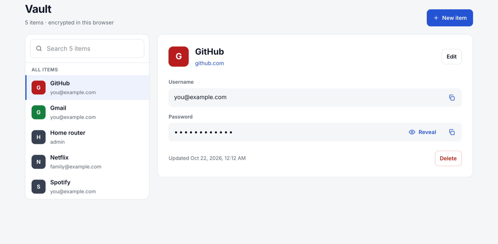
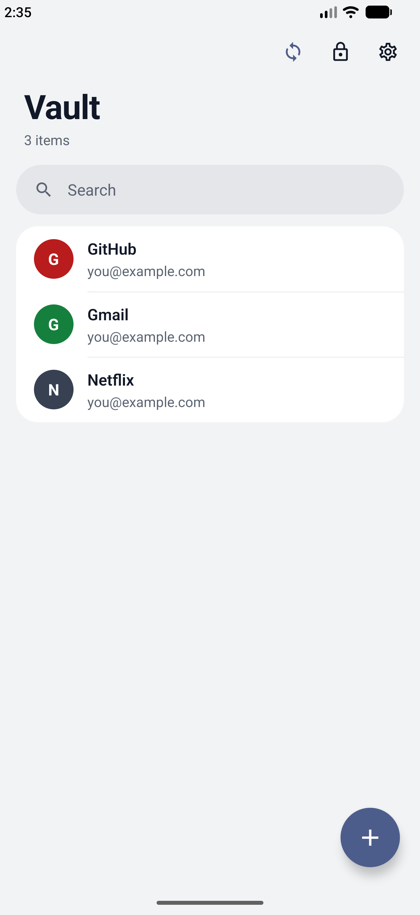
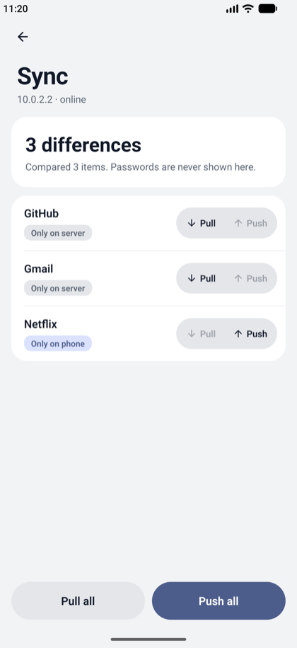
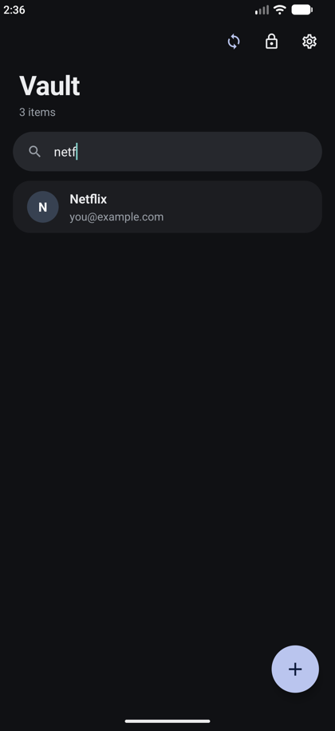

# Rejtek

A self-hosted password manager for one household. A small server runs in Docker on the home network and is **never exposed to the internet**. Everyone gets an encrypted vault that they can use from:

- the **web app**, served by that server,
- the **Android app**, which works fully offline and syncs by hand when on home Wi-Fi,
- a **Firefox extension**, which suggests, copies and fills logins.

Encryption is end-to-end: the server only stores ciphertext and never sees a master password or key.

<p>
  
</p>
<p>
  
  
  
</p>

## How it works

- **Accounts:** register in the web app with a username and master password. There is **no password reset**: a forgotten master password means the data is lost.
- **Encryption:** the clients do all the work, with libsodium. The master password goes through Argon2id to produce an encryption key and an auth key. The encryption key wraps a random vault key, which encrypts each item with XChaCha20-Poly1305. The server stores a hash of the auth key and the encrypted items.
- **Phone:** the app is usable without an account; its local vault is protected by the phone's fingerprint or PIN. To pair, scan the QR code on the web app's **Devices → Pair** page and enter the master password once. Sync is manual: the app lists which items differ (names only, never passwords) and you pull or push each one, or all at once.
- **Browser extension:** pair it with the link from the same Pair page, then unlock it with the master password.
- **HTTPS and pinning:** the server creates a self-signed HTTPS certificate on first start. The phone pins that certificate's fingerprint, which comes from the pairing QR. Firefox trusts it once you accept it.

`CLAUDE.md` holds the full design, security model and API.

## Repository layout

| Path             | What                                                                                           |
| ---------------- | ---------------------------------------------------------------------------------------------- |
| `server/`        | C# .NET 10 Minimal API, EF Core + SQLite, serves the web app. Tests in `server/tests`.         |
| `web/`           | Web app: React 19, Vite, React Router, TanStack Query, Tailwind v4.                            |
| `mobile/`        | Android app: Expo SDK 58 (React Native, dev build), Expo Router, SQLite.                       |
| `extension/`     | Firefox extension (Manifest V3, React popup).                                                  |
| `packages/core`  | Shared TypeScript: crypto, item models, API client, pairing, sync diff. All crypto lives here. |
| `packages/ui`    | Shared React components (web + extension).                                                     |
| `packages/theme` | Tailwind design tokens (light/dark).                                                           |
| `docs/`          | Screenshots.                                                                                   |

The TypeScript packages form one npm workspace. The server is a separate .NET solution (`server/Rejtek.slnx`).

## Development

Requirements:

- Node 24 (see `.nvmrc`)
- .NET 10 SDK
- Docker
- For the Android app: Android Studio (SDK and an emulator) and a JDK
- Firefox 142 or newer for the extension

```sh
npm install                  # all TypeScript workspaces
npm run check                # lint, format check, typecheck, tests (core, web, extension)
cd server && dotnet test     # server tests; also: dotnet format --verify-no-changes
```

### Server + web app

```sh
cd server && dotnet run --project src/Rejtek.Server   # http://localhost:5080, SQLite in a local file
npm run dev -w @rejtek/web                            # Vite dev server, proxies /api to :5080
```

To try the production setup locally, run `docker compose up -d --build` and open https://localhost:8443.

To change the database schema, edit the entities in `server/src/Rejtek.Server/Data`, then add a migration. Migrations are applied when the server starts.

```sh
cd server && dotnet tool restore
dotnet ef migrations add <Name> --project src/Rejtek.Server --output-dir Data/Migrations
```

### Android app

```sh
npm run android -w @rejtek/mobile   # generates android/, builds and installs the dev build
npm start -w @rejtek/mobile         # Metro bundler (don't set CI=1: it disables reloads)
```

- **Native code:** `mobile/android/` is generated, so never edit it. Add native dependencies with `npx expo install <pkg>` and configure them in `app.json`. The certificate-pinning HTTP client is a local Expo module in `mobile/modules/pinned-fetch` (Kotlin).
- **Emulator:** the emulator reaches the host machine at `10.0.2.2`, so a local Docker server is `https://10.0.2.2:8443`. Unlocking needs a screen lock on the emulator (`adb shell locksettings set-pin 1234`). Simulate a fingerprint with `adb emu finger touch 1`.
- **Pairing without a camera:** use the deep link, e.g. `adb shell am start -d 'rejtek://pair?p=…'` (quote the URL).

### Firefox extension

```sh
npm run build -w @rejtek/extension      # → extension/dist
npm run lint:ext -w @rejtek/extension   # Mozilla's web-ext lint
```

Load the extension in Firefox: open `about:debugging`, go to **This Firefox**, click **Load Temporary Add-on** and pick `extension/dist/manifest.json`. After a rebuild, press **Reload** there. A temporary add-on is removed when Firefox closes.

## Deployment

### Server (Docker)

Run this on an always-on machine in the home network, such as a home server.

```sh
cp .env.example .env          # set REJTEK_HOST to the server's LAN IP or host name
docker compose up -d --build  # → https://<REJTEK_HOST>:8443
```

- **Port:** do not forward port 8443 on the router.
- **Data:** the SQLite database and the TLS certificate live in the `rejtek-data` volume, under `/data`.
- **Certificate:** it is created on first start for `REJTEK_HOST`. Keep the volume: a new certificate means every phone has to pair again and every browser has to trust it again. Pick `REJTEK_HOST` carefully, ideally with a fixed DHCP lease for the server.
- **Backups:** copy the volume. It contains ciphertext only, but the hashes and wrapped keys still deserve care.
- **Updates:** `git pull && docker compose up -d --build`. Database migrations run automatically.
- **First use:** open `https://<REJTEK_HOST>:8443` in a browser on the LAN. Use that address rather than `localhost`, because the pairing QR code contains the page's address. Accept the self-signed certificate after comparing its fingerprint with the one on the Pair page, then register.
- **Image:** `server/Dockerfile` builds the web app, publishes the server and produces a small "chiseled" image with no shell that runs as non-root. The build context is the repository root.

#### Hosts that cannot build the image

If the server is too slow to build the image itself, build it on a development machine for the server's CPU and copy it over:

```sh
docker buildx build --platform linux/amd64 -f server/Dockerfile -t rejtek:latest --load .
docker save rejtek:latest | gzip | ssh <user>@<server> 'gunzip | docker load'
ssh <user>@<server> 'cd <deploy-dir> && docker compose up -d'
```

The build stages run natively and cross-compile, so building an amd64 image on Apple Silicon needs no emulation. On first setup, copy `docker-compose.yml` and a filled-in `.env` into the deploy directory. `image: rejtek:latest` in the compose file makes the server use the loaded image instead of building one.

### Android app (sideloaded, no Play Store)

Release builds are signed with the owner's own key, using the config plugin in `mobile/plugins/with-release-signing.js`. Without the key, a release build fails rather than falling back to the public debug key.

**One-time setup:**

1. Create the key. `keytool` comes with the JDK and asks for a password:
   ```sh
   mkdir -p ~/.android-keys
   keytool -genkeypair -v -storetype PKCS12 -keystore ~/.android-keys/rejtek-release.jks \
     -alias rejtek -keyalg RSA -keysize 4096 -validity 36500 -dname "CN=Rejtek"
   ```
2. Add these lines to `~/.gradle/gradle.properties`. That file is outside the repo, so make it readable only by you. With PKCS12, the key password is the same as the store password.
   ```properties
   REJTEK_RELEASE_STORE_FILE=/Users/<you>/.android-keys/rejtek-release.jks
   REJTEK_RELEASE_STORE_PASSWORD=<password>
   REJTEK_RELEASE_KEY_ALIAS=rejtek
   REJTEK_RELEASE_KEY_PASSWORD=<password>
   ```
3. **Back up the `.jks` file and its password**, for example in the vault itself and on an offline drive. Every update must be signed with this same key. Without it, the only way to update is to uninstall, which deletes the phone's local vault.

**Build:**

```sh
npm run build:apk -w @rejtek/mobile
# → mobile/android/app/build/outputs/apk/release/app-release.apk (arm64-v8a only)
```

**Install:** copy the APK to the phone and open it in the file manager. Allow "install unknown apps" for that app when Android asks. Alternatively, connect the phone with USB debugging and run `adb install -r app-release.apk`.

**Updates:** raise `version` in `mobile/app.json`, then build and install over the existing app. Local data is kept.

### Firefox extension

Regular Firefox only installs extensions signed by Mozilla. To get yours signed without publishing it, use the **unlisted** channel:

1. Create API credentials on addons.mozilla.org: **Developer Hub → Manage API Keys** (JWT issuer + secret; keep the secret out of the repo and shell history).
2. Build, then sign. The bundle is minified, so the committed source goes along for Mozilla's review:
   ```sh
   npm run package -w @rejtek/extension
   git archive --format zip -o extension/artifacts/rejtek-source.zip HEAD
   cd extension
   # zsh: prompts without echoing the secret or saving it in history
   read -r "AMO_JWT_ISSUER?JWT issuer: "; read -rs "AMO_JWT_SECRET?JWT secret: "; echo
   npx web-ext sign --source-dir dist --channel unlisted \
     --api-key "$AMO_JWT_ISSUER" --api-secret "$AMO_JWT_SECRET" \
     --upload-source-code artifacts/rejtek-source.zip --artifacts-dir artifacts
   ```
   The signed `.xpi` lands in `extension/artifacts/` after a few minutes.
3. Install it in Firefox: `about:addons` → gear → **Install Add-on From File…**. Installing a newer signed version updates it in place.
4. Connect: open the server once in Firefox and accept its certificate (compare the fingerprint), then on the web **Pair** page click **Copy link for the browser extension** and paste it into the popup.

Each signed version needs a higher `version` in `extension/public/manifest.json`; Mozilla never signs the same version twice.

## Maintenance notes

- **Crypto:** it lives only in `packages/core`. Encrypted blobs carry a version (`v: 1`), so a format change must add a new version and keep reading the old one.
- **Shared code:** web, extension and mobile all consume `packages/core` source directly. Imports there are extensionless so Metro can bundle them.
- **Web app dependencies:** when the web app gains a new workspace dependency, add it to `server/Dockerfile`, which copies only the packages the web app needs.
- **TypeScript:** pinned to 6.x until `typescript-eslint` supports 7.
- **Security headers:** the server sends a strict CSP (`script-src 'self' 'wasm-unsafe-eval'`). No inline scripts, no CDNs; fonts are self-hosted.
- **Commits:** one commit per meaningful milestone.

## License

MIT, see [LICENSE](LICENSE).
